# //pub/examples/script/csgrs

Worked examples of the [csgrs plugin for PartCAD](https://github.com/partcad/partcad-csgrs) — parts, sketches
and checks built by [csgrs](https://github.com/timschmidt/csgrs), the exact-arithmetic constructive solid geometry
kernel written in Rust. Every part type, every sketch type, the ready-made parametric parts and sketches, the
`hyperdrc` PCB check, and the types that run in the plugin's own container image each have an example here.

Each topic is a package of its own, in the directory named after it. The plugin is referred to by the path the
PartCAD index gives it, `//pub/feature/cad/csgrs`, both here and inside the index (see `deps/pub`).

| Package | What it shows |
|---|---|
| [`gears`](#gears) | `gear` (spur, helical, cycloidal), `rack`, the ready-made `spur_gear`, a meshing pair |
| [`lattices`](#lattices) | `tpms`: gyroid, Schwarz P and Schwarz D blocks |
| [`airfoils`](#airfoils) | `airfoil`: NACA 0012 and 4412 wings |
| [`text`](#text) | `text` in Hershey single-stroke fonts, `truetype` in a downloaded font, the ready-made `text` |
| [`raster`](#raster) | `image`: a PNG traced and extruded, and inverted |
| [`models`](#models) | `vrml`: KiCad component models |
| [`csg`](#csg) | `csg`: trees of shapes with booleans, extrusions, revolve, sweep, hull, Minkowski and parameters |
| [`sketches`](#sketches) | every sketch type, the ready-made `gear_outline`, and parts PartCAD extrudes from them |
| [`pcb`](#pcb) | the `hyperdrc` qualification test on a KiCad board |
| [`container`](#container) | the `_in_container` types, run in the plugin's image |

It needs PartCAD 0.10.25 or newer: the first with `sketchTypes:`, and with `container:` for part and sketch types.

```shell
pc inspect //gears:pair
pc render -t png //lattices:gyroid
pc inspect "//csg:bracket;width=60.0"
pc qual test --other //pcb:board
```

## gears

Involute and cycloidal gears from the `gear` part type, an involute rack from `rack`, and a pair: the pinion
meshing with the plugin's ready-made `spur_gear`, set by its parameters in the assembly
(`//pub/feature/cad/csgrs:spur_gear;module=1.5,teeth=24,...`). Two gears of one module mesh at the sum of their
pitch radii — 1.5 × (24 + 12) / 2 = 27 mm — with the pinion turned half a tooth.

`wheel` declares its tooth count as a parameter, so `//gears:wheel;teeth=36` is the same gear with 36 teeth.

<table><tr>
<td>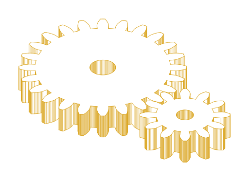</td>
<td>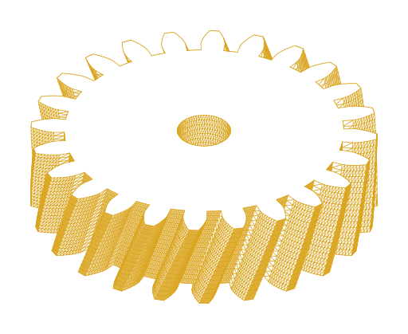</td>
<td>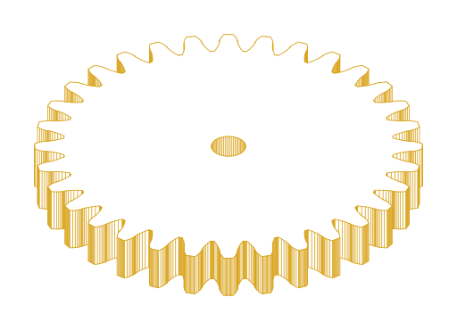</td>
</tr></table>

## lattices

Triply periodic minimal surfaces from the `tpms` part type — light, stiff in every direction, and printable without
supports. `period` is the cell size, `thickness` the wall, and `resolution` how finely the field is sampled.

<table><tr>
<td>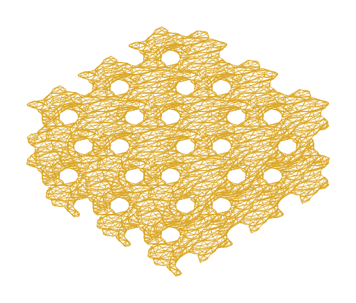</td>
<td>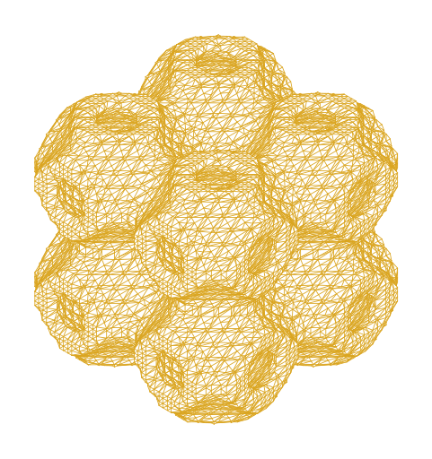</td>
<td>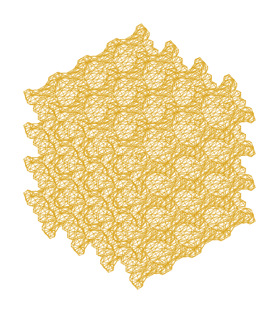</td>
</tr></table>

## airfoils

NACA four-digit sections from the `airfoil` part type, extruded along their span: `0012` is symmetric, `4412`
cambered.

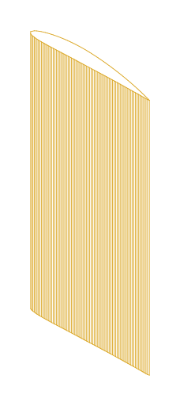

## text

`text` draws in the 33 Hershey single-stroke fonts csgrs carries, given a stroke width; `truetype` reads a font
file — here [Bungee](https://fonts.google.com/specimen/Bungee) (SIL Open Font License), downloaded from the Google
Fonts repository on first use and checked against its SHA-256 (`fileFrom: url`, `fileHash:`). `sign` is the plugin's
ready-made `text` part, aliased with its text set.

<table><tr>
<td>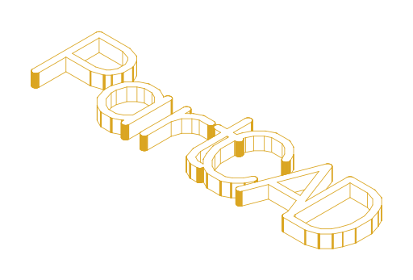</td>
<td>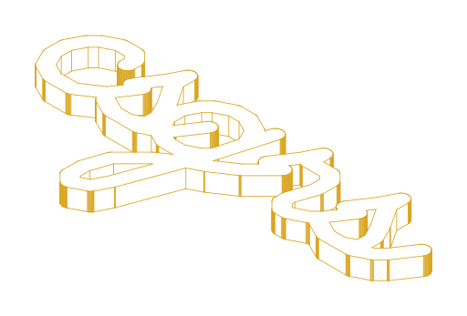</td>
<td>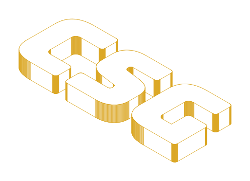</td>
</tr></table>

## raster

The `image` part type traces a PNG — every pixel at or above `threshold` is material — and extrudes it.
`badge` is [`badge.png`](raster/badge.png) as it is; `stencil` is the same picture with `invert: true`.

<table><tr>
<td></td>
<td>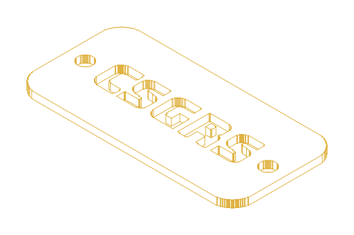</td>
<td>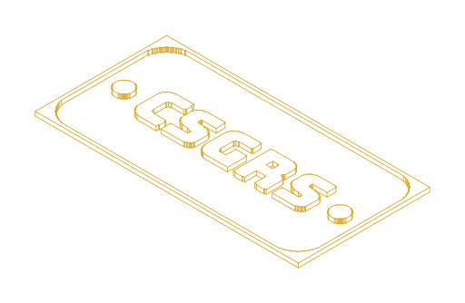</td>
</tr></table>

## models

The `vrml` part type reads VRML 2.0 — here two of KiCad's component models, from the archived
[KiCad/kicad-packages3D](https://github.com/KiCad/kicad-packages3D) (CC-BY-SA 4.0 with KiCad's library exception),
downloaded on first use. KiCad draws them in tenths of an inch: `units: 2.54`.

<table><tr>
<td>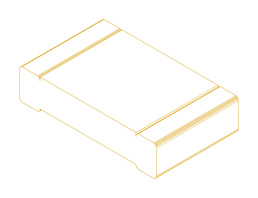</td>
<td>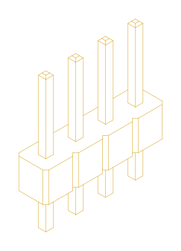</td>
</tr></table>

## csg

The `csg` part type reads a tree of shapes from `<name>.csgrs`, in YAML; `${...}` in it is worked out over the part's
parameters. See [the plugin's README](https://github.com/partcad/partcad-csgrs#csg-trees) for every shape a tree
may hold.

| Part | Tree | What it uses |
|---|---|---|
| `bracket` | [`bracket.csgrs`](csg/bracket.csgrs) | `difference`, `union`, `cuboid`, `cylinder`, an extruded `polygon`; `width`, `height`, `hole` parameters |
| `knob` | [`knob.csgrs`](csg/knob.csgrs) | a `star` extruded with `twist`; a D-shaped hole from an `intersection` of profiles |
| `enclosure` | [`enclosure.csgrs`](csg/enclosure.csgrs) | a hollow box with a lip, and slots, all one `difference` |
| `spacer` | [`spacer.csgrs`](csg/spacer.csgrs) | `revolve` of a `polygon` |
| `sprocket` | [`sprocket.csgrs`](csg/sprocket.csgrs) | a `gear_profile` node, `circle`s cut from it in the plane, then `extrude` |
| `rounded` | [`rounded.csgrs`](csg/rounded.csgrs) | `minkowski` of a block and a sphere |
| `vase` | [`vase.csgrs`](csg/vase.csgrs) | `offset` of an `ngon`, extruded with `twist` and `scale` |
| `pipe` | [`pipe.csgrs`](csg/pipe.csgrs) | `sweep` of a ring along a path |
| `hull` | [`hull.csgrs`](csg/hull.csgrs) | `hull` of a block and a cube |

<table><tr>
<td>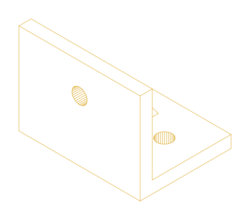</td>
<td>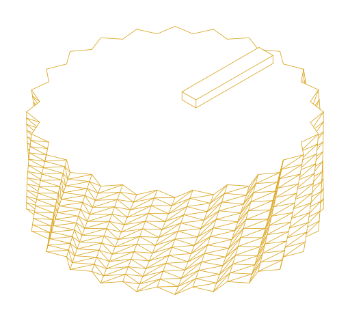</td>
<td>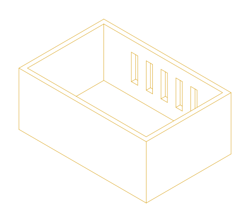</td>
<td>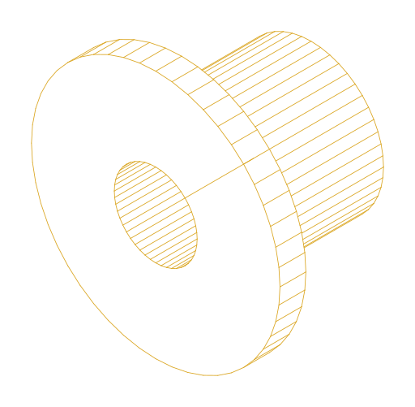</td>
</tr><tr>
<td>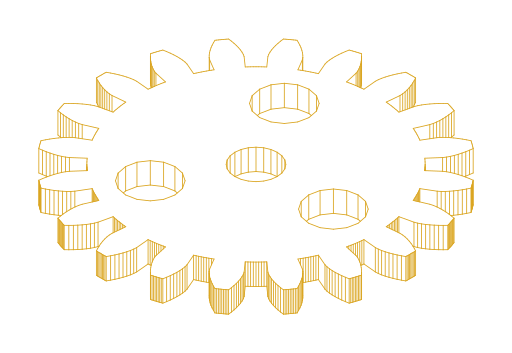</td>
<td>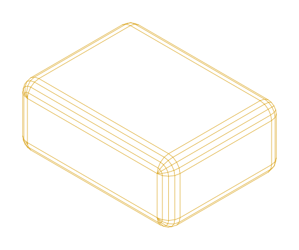</td>
<td>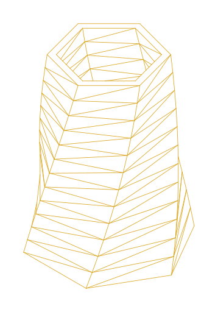</td>
<td>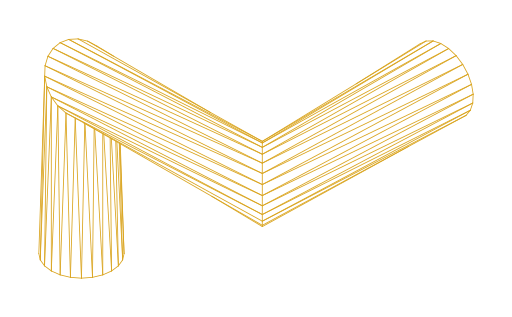</td>
</tr></table>

## sketches

A sketch of every sketch type — `gear_profile`, `rack_profile`, `airfoil_profile`, `text_profile`,
`truetype_profile`, `image_profile`, `csg_profile` — and the plugin's ready-made `gear_outline`. A sketch is the
region a part type would extrude, its boundary the curves csgrs kept: the TrueType lettering is the font's own
Bézier curves, not a polygon. `gear_plate`, `mounting_plate` and `wing_stub` are PartCAD's own `extrude` of them.

<table><tr>
<td>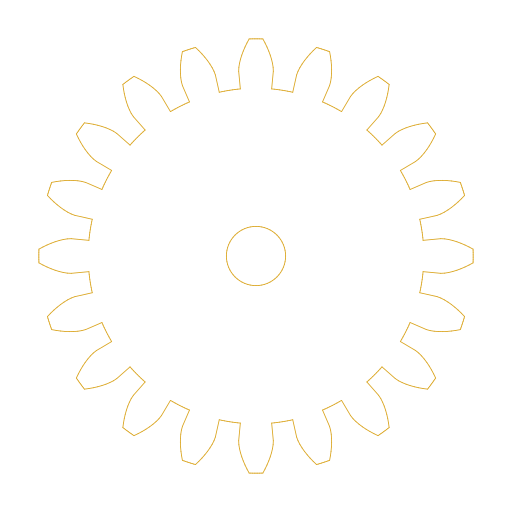</td>
<td>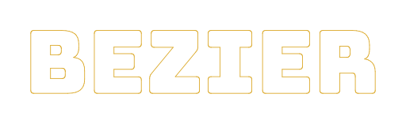</td>
<td>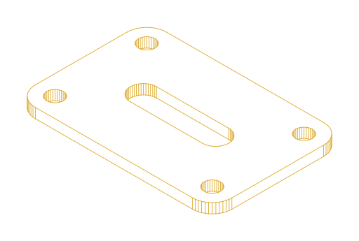</td>
</tr></table>

## pcb

A KiCad board ([`board.kicad_pcb`](pcb/board.kicad_pcb)) with the plugin's `hyperdrc` test declared on it twice:
`drc`, which fails on an error and reports every warning, and `drc_strict`, which fails on a warning too, less the
checks the board deliberately leaves to the assembly house (`ignore:`). `pc qual test --other //pcb:board` runs
both — this board passes both.

## container

Every type of the plugin has a twin named `<type>_in_container`, which PartCAD runs in the plugin's container image as
it is (`container:`) instead of in a Python sandbox: nothing installed on the machine, and one environment for
every part whatever the machine. They need a container runtime (Docker), and fail without one where the plain types
fall back. `pinion`, `lattice` and `block` are part types run that way, and `outline` a sketch type, which
`gear_plate` extrudes.

## Tests

[`tests/test_examples.py`](tests/test_examples.py) builds every part, sketch and assembly here with PartCAD and
measures the ones whose size says whether they came out right; [CI](.github/workflows/ci.yml) runs it with
PartCAD's development branch on Ubuntu, where Docker builds the `container` examples too.

```shell
pip install pytest pyyaml build123d "partcad>=0.10.25"
pytest
```

The pictures are `pc render -t png` of each object, and are checked in.

## Licences

These examples are Apache-2.0. The font and the KiCad models they download are not part of this repository and keep
their own licences: Bungee is under the SIL Open Font License 1.1, the KiCad models under CC-BY-SA 4.0 with
KiCad's library exception.
